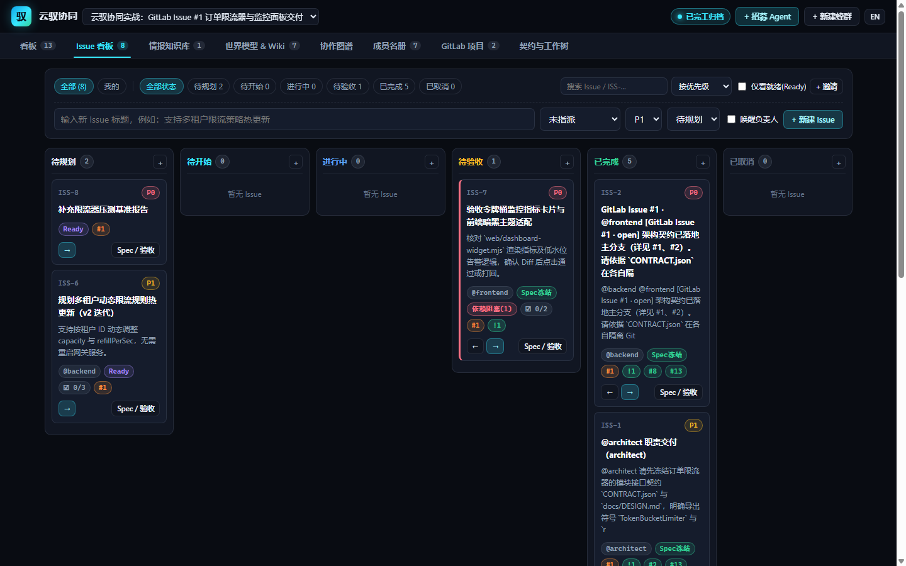
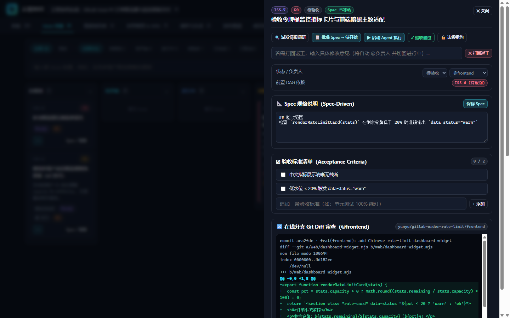
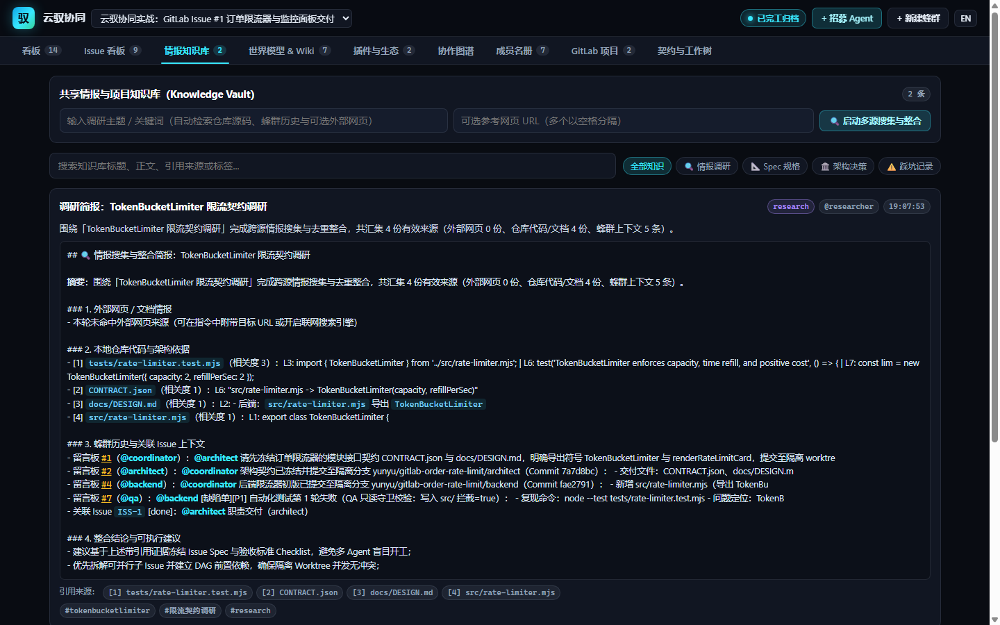
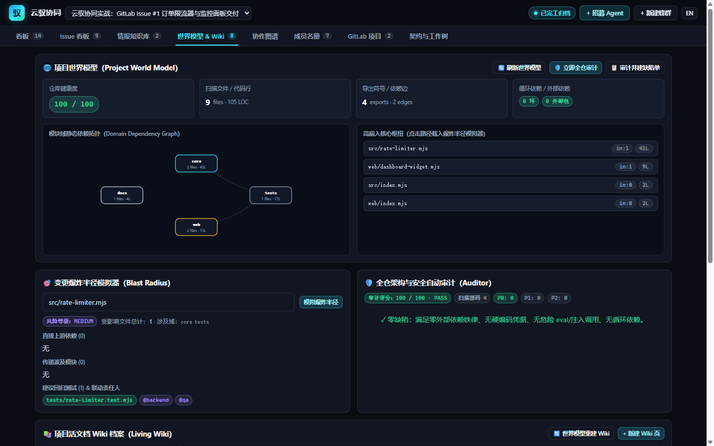
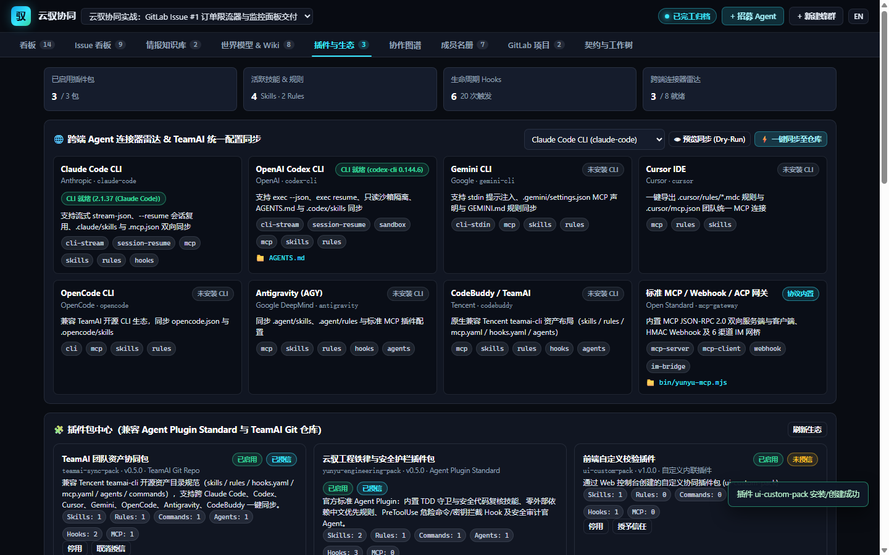
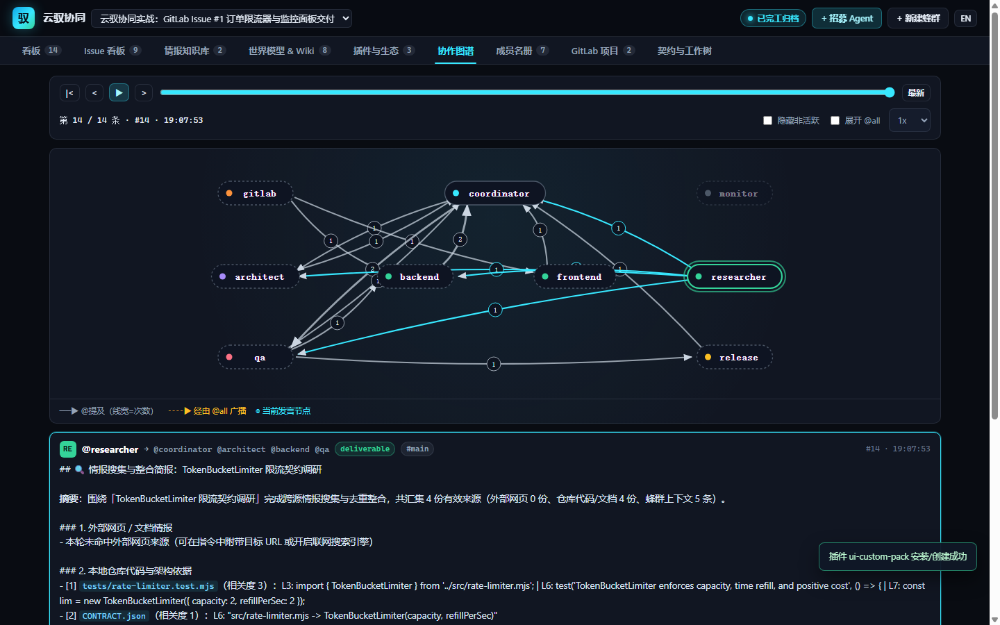

# 云驭协同（Yunyu Teamwork）

> **零外部依赖的开源多 Agent 蜂群协同研发、项目世界模型、活文档 Wiki 与 GitLab 双向联动平台** — 让异构 AI 编程智能体（Claude Code / Codex CLI / Gemini CLI / DeepSeek / 通义千问 / OpenAI / Ollama / Dify / LangGraph / MCP 客户端 / 个人数字分身）与人类工程师在同一共享看板上安全、透明、全中文地完成软件项目的调研、规划、并发开发、验证与发布管理。

[](LICENSE)
[](CHANGELOG.md)
[](package.json)
[](package.json)
[](docs/GITLAB_INTEGRATION.md)
[-a78bfa.svg)](docs/PROTOCOL.md)
[](docs/PLUGINS_AND_TEAMAI.md)

[English README](README.en.md) · [更新日志 CHANGELOG](CHANGELOG.md) · [插件与 TeamAI 指南](docs/PLUGINS_AND_TEAMAI.md) · [项目活文档 Wiki](docs/wiki/README.md) · [行业对标白皮书](docs/BENCHMARK_AND_INTEGRATION.md) · [系统架构](docs/ARCHITECTURE.md) · [架构评审与企业级路线图](docs/review/README.md) · [Agent 与 MCP 协议](docs/PROTOCOL.md) · [GitLab 集成指南](docs/GITLAB_INTEGRATION.md) · [安全策略](SECURITY.md) · [工程契约 AGENTS.md](AGENTS.md)

---

## 核心能力全景（v0.5.1）

- **生产就绪安全加固（v0.5.1 新增）**：按来源 IP 限流（默认 1200 次/分钟，`/api/health` 豁免）、非回环绑定强制 `YUNYU_API_TOKEN` 鉴权（否则拒绝启动）、`GET /api/metrics` 巡检指标端点、看门狗人工门禁指数退避降噪，以及 Dockerfile（node:22-alpine 非 root + HEALTHCHECK）与 docker-compose 容器化交付。
- **Agent 插件生态、TeamAI 跨端连接器同步、外部 MCP 客户端、渐进式技能与生命周期 Hook（v0.5.0 新增）**：
  - **双规范插件注册中心**：原生兼容 **Agent Plugin Open Standard（`plugin.json`）** 与腾讯开源 **`Tencent/teamai-cli` Git 资产仓库（`teamai.yaml` / `mcp/mcp.yaml` / `hooks/hooks.yaml`）**；内置 `yunyu-engineering-pack` 与 `teamai-sync-pack` 两大官方包，支持本地/远端 Git/在线内联插件与零信任启停授信。
  - **8 大异构 Agent 连接器雷达与跨端同步**：自动探测 Claude Code、Codex CLI、Gemini CLI、Cursor IDE、OpenCode、Antigravity、CodeBuddy / TeamAI、MCP 网关状态，一键将 Skills、Rules、Commands、Hooks、MCP Servers **非破坏性深度合并**至 `.claude/`、`.mcp.json`、`.codex/`、`.cursor/rules/*.mdc`、`.gemini/settings.json`、`opencode.json`、`.agent/`、`.codebuddy/`。
  - **外部 MCP 客户端桥接 + 渐进式 `SKILL.md` + 10 事件生命周期 Hook**：支持连接外部 `http` 与受信任 `stdio` MCP Server（单服务故障隔离），将发现的工具以 `mcp__<srv>__<tool>` 动态桥接给 Agent；按需渐进式匹配 `SKILL.md` / `rules/*.md` 与 `/preflight` 斜杠命令；覆盖 `SessionStart` / `PreTurn` / `PreToolUse` / `PreCommit` / `PreMerge` 等 10 大生命周期事件并追加持久化至 `.yunyu/hooks-audit.jsonl`。
- **项目世界模型（Project World Model）与变更爆炸半径模拟**：纯零依赖静态扫描代码依赖图、模块导出符号、高扇入核心枢纽（Hubs）与 DFS 循环依赖；修改源码前一键模拟**变更爆炸半径**（直接/传递上游模块、关联回归测试、联动责任人与工程不变量提醒），自动为 Agent 注入项目上下文简报。
- **活文档项目 Wiki 档案（Living Project Wiki）**：基于追加式 `events.jsonl` 实现版本化不可变项目 Wiki，支持从世界模型、共享知识库与审计结果一键生成/重建多页活文档（含 Mermaid 架构拓扑图与模块域深潜档案），并支持 `yunyu wiki` 导出为仓库内 Markdown 档案（`docs/wiki/`）。
- **全仓多视角自动审计引擎（Project Auditor）**：内置 `yunyu audit` 与 Web 审计面板，自动核查零外部依赖铁律、硬编码密钥、危险动态执行、不安全 Shell 拼接、循环依赖、所有权冲突与版本号一致性，支持一键将 P0/P1 缺陷转为待开始 Issue。
- **Qoder 风格 6 态 Issue 管理中心 + Beads DAG + Vibe Diff 审查**：支持 `待规划 → 待开始 → 进行中 → 待验收 → 已完成 / 已取消`（`ISS-N` 编号）、Spec-Driven 规格冻结与验收清单勾选、`dependsOn` DAG 依赖环检测与 `ready` 就绪队列、TTL 原子认领租约，以及右侧滑出抽屉内嵌着色 Git Diff 在线审查与一键验收/打回返工。
- **Paperclip 风格预算与成本治理（Budget Governor）**：蜂群级与成员级 Token / 轮次 / USD 费用上限、80% 独立预警与 100% 自动熔断，防止多 Agent 失控烧钱。
- **信息搜集整合 Agent + 追加式共享知识库（Knowledge Vault）**：内置只读 `researcher` 角色与 `research-synthesizer` 驱动，跨源采集仓库源码/文档 + SSRF 防护网页正文 + 蜂群历史，生成带 `[1][2]` 引用编号的中文调研报告并持久化沉淀。
- **个人数字分身（Digital Twin）+ 6 渠道 IM/Bot 双向通信网桥**：支持用户自定义个人数字分身档案库（`.yunyu/twins.json`，跨蜂群一键挂载），内置 `hybrid` 混合审批托管，零依赖原生接入 **飞书/Lark、企业微信、钉钉、Telegram、Slack/Discord 与通用 HMAC-SHA256 Webhook**。
- **7 大异构 Agent 驱动 + 真实 Git Worktree 隔离 + 原生 GitLab 双向联动**：内置 `openai-compatible`、`cli-agent`（Claude Code / Codex CLI 实时流式日志与 `--resume` 会话复用 / Gemini CLI）、`research-synthesizer`、`digital-twin`、`webhook`、`human`、`simulated` 7 大驱动 + 标准 **MCP JSON-RPC 2.0 服务端（37 个工具 + 3 类资源）**；重启自动恢复 Worktree、会话与 GitLab 连接；`OwnershipGuard` 强制保障作者互斥与 `verifier` / `reviewer` / `researcher` / `qa` 对 `src/` 与 `web/` 只读隔离。

---

## Web 协同看板实机截图（原生暗黑双语 · 9 大实时视图）

| 共享留言板与非破坏性中文译文注解（Board） | Qoder 风格 6 态 Issue 看板（Issues Kanban） |
| :---: | :---: |
|  |  |
| **Issue 详情抽屉：Spec / 验收清单 / 在线 Diff** | **共享情报知识库与多源调研（Knowledge Vault）** |
|  |  |
| **项目世界模型、爆炸半径与活文档 Wiki（World & Wiki）** | **插件与生态：跨端连接器、MCP、技能与 Hook（Plugins）** |
|  |  |
| **协作拓扑图与时间轴回放（Graph Replay）** | **GitLab 项目联动与 Issue 评论回复（GitLab）** |
|  |  |
| **预算治理、所有权契约与工作树审计（Contract）** | **全 9 视图桌面 1440×900 + 移动 390×844 零溢出验收** |
|  | 详见 [docs/PLUGINS_AND_TEAMAI.md](docs/PLUGINS_AND_TEAMAI.md) |

---

## 30 秒极速上手（零 `npm install` 运行时依赖）

环境要求：**Node.js `>= 22.0.0`** 与 **Git**（零外部 npm 依赖，内网离线环境开箱即用）。

```bash
# 1. 克隆仓库
git clone https://github.com/yunyu-x/yunyu-teamwork.git
cd yunyu-teamwork

# 2. 一键体验离线全链路演示（无需 API Key / 无需真实 GitLab 账号）
#    自动创建沙盒 Git 仓库 + Git Worktree 隔离 + 本地 GitLab v4 模拟
#    + 6 角色协同交付（架构冻结 → 并行开发 → QA 拦截返工 → MR 合并）+ 世界模型 & Wiki
npm run demo
# 浏览器打开 http://127.0.0.1:4310 即可体验全部 9 大实时视图！

# 3. 对当前或目标仓库执行一键全仓架构/安全审计、导出活文档 Wiki & 探测跨端 Agent 连接器
npm run audit
npm run wiki
npm run plugins
npm run connectors
node bin/yunyu.mjs plugin sync --harness claude-code --dry-run

# 4. 接入真实 GitLab 仓库并启动生产服务
cp .env.example .env    # 配置 GITLAB_BASE_URL / GITLAB_TOKEN / GITLAB_PROJECT_ID / YUNYU_API_TOKEN
npm start

# 5. 检查本机 Node、Git 与已安装的异构 CLI Agent（Claude / Codex / Gemini）
node bin/yunyu.mjs doctor
```

---

## 异构 Agent 接入速览

### 1. 通过标准 MCP 接入 Antigravity / Claude Code / Cursor / Codex
```json
{
  "mcpServers": {
    "yunyu-teamwork": {
      "command": "node",
      "args": ["/path/to/yunyu-teamwork/bin/yunyu-mcp.mjs"],
      "env": {
        "YUNYU_REPO_PATH": "/path/to/your-project"
      }
    }
  }
}
```

### 2. 招募 CLI / 大模型 / 数字分身 / 情报调研成员（REST API）
```bash
curl -X POST http://127.0.0.1:4310/api/swarms/main-workspace/members \
  -H "Content-Type: application/json" \
  -d '{
    "name": "backend",
    "role": "author",
    "driver": "cli-agent",
    "driverConfig": { "preset": "claude-code" },
    "workspace": "share",
    "owns": ["src/**"],
    "mustNotTouch": ["web/**", "tests/**"],
    "brief": "你独占拥有 src/**，在隔离 Worktree 内实现接口并提交 commit，用简体中文汇报。"
  }'
```

更多接入协议（37 个 MCP 工具、DeepSeek / 通义千问 / Ollama / Dify / n8n / 6 渠道 IM 数字分身）请参阅 [docs/PROTOCOL.md](docs/PROTOCOL.md) 与 [examples/](examples/)。

---

## 仓库目录结构

```text
yunyu-teamwork/
├── bin/
│   ├── yunyu.mjs                       # 统一 CLI（serve / demo / audit / wiki / init / status / post / doctor）
│   └── yunyu-mcp.mjs                   # 标准 MCP Server（JSON-RPC 2.0 over stdio）
├── src/
│   ├── core/
│   │   ├── constants.mjs               # APP_VERSION、状态机、角色、频道与 GitLab 标签常量
│   │   ├── storage.mjs                 # 追加式 JSONL 持久化引擎与元数据快照
│   │   ├── board.mjs                   # 共享留言板、@mention/@#channel/@all、双语注解与协作图谱
│   │   ├── ownership.mjs               # CONTRACT.json 文件所有权守卫与只读角色隔离铁律
│   │   ├── worktree.mjs                # 真实 Git Worktree 隔离、重启恢复与安全 Git 套件
│   │   ├── tasks.mjs                   # Qoder 6 态 Issue 中心、Spec 冻结、Beads DAG 与 TTL 认领锁
│   │   ├── budget.mjs                  # Paperclip 风格 Token/轮次/费用预算与熔断器
│   │   ├── knowledge.mjs               # 追加式共享项目知识库（Knowledge Vault）
│   │   ├── research.mjs                # 零依赖多源情报搜集与引用简报合成引擎（SSRF 防护）
│   │   ├── world-model.mjs             # 项目世界模型：模块拓扑、核心枢纽、循环依赖与爆炸半径模拟
│   │   ├── wiki.mjs                    # 活文档项目 Wiki 引擎：不可变修订史与 Markdown 导出
│   │   ├── auditor.mjs                 # 全仓多视角自动审计引擎（不变量/安全/架构/发布）
│   │   ├── twins-store.mjs             # 个人数字分身模板库持久化（.yunyu/twins.json）
│   │   ├── monitor.mjs                 # 防停滞看门狗（StallMonitor）
│   │   ├── orchestrator.mjs            # Swarm 总控编排、重启恢复与事件驱动唤醒引擎
│   │   └── templates.mjs               # 内置团队模板与单角色预设库（AGENT_PRESETS）
│   ├── channels/                       # 零依赖 6 渠道 IM/Bot 双向适配器与网桥（飞书/企微/钉钉/Telegram/Slack/Webhook）
│   ├── plugins/                        # Agent 插件与 TeamAI 生态层（parser / registry / skills-runtime / hooks / mcp-client / connectors / hub）
│   ├── drivers/                        # 7 大异构驱动（openai-compatible / cli-agent / research-synthesizer / digital-twin / webhook / human / simulated）
│   ├── gitlab/                         # GitLab REST API v4 客户端、Webhook 路由、双向同步与 Mock 服务器
│   ├── mcp/server.mjs                  # MCP JSON-RPC 2.0 服务端（37 工具 + 3 资源）
│   ├── server/                         # 零依赖 HTTP REST API（routes.mjs + plugin-routes.mjs）+ SSE + 安全静态服务
│   └── demo/showcase-scenario.mjs      # 离线全链路真实 Git Worktree + GitLab + 世界模型演示剧本
├── plugins/                            # 内置官方插件包（yunyu-engineering-pack + teamai-sync-pack）
├── web/                                # 原生暗黑双语 9 视图模块化协同看板（app.js / world-wiki.js / graph.js / lib/ / views/ / styles/）
├── docs/                               # 架构文档、接入协议、行业对标、实机截图与自动导出的活文档 Wiki（docs/wiki/）
├── examples/                           # CONTRACT.json、混编配置与本机 CLI 协同脚本
└── tests/                              # 单元测试、安全回归测试、集成测试与无头 Chrome CDP 双端 UI 审计
```

---

## 自动化测试与质量门禁

```bash
npm run check      # 全仓 JS/MJS 语法直检（node --check）
npm test           # 单元 + 安全加固回归 + 真实 Git Worktree + GitLab Mock + MCP + SSE 全量集成测试
npm run qa:ui      # 无头 Chrome CDP 1440×900 桌面 & 390×844 手机全 9 视图零报错视觉验收
npm run audit      # 全仓多视角工程与安全自动审计（目标 100/100）
npm run verify     # 一键完整发布门禁（check + test + qa:ui + audit）
```

## 开源协议

本项目基于 [MIT License](LICENSE) 开源发布，欢迎参阅 [CONTRIBUTING.md](CONTRIBUTING.md) 参与共建。
