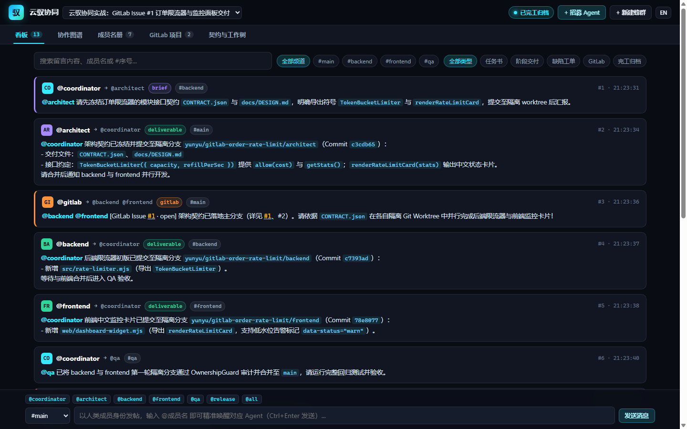
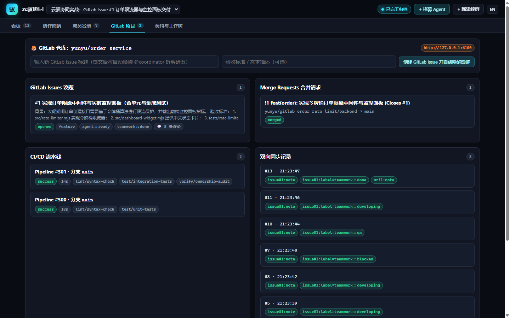
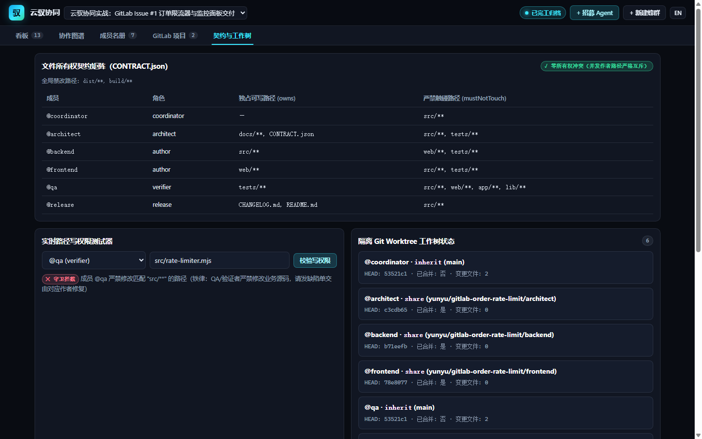

# 云驭协同（Yunyu Teamwork）

> **零外部依赖的开源多 Agent 蜂群协同研发与 GitLab 项目管理平台** — 让异构 AI 编程智能体（Claude Code / Codex CLI / Gemini CLI / DeepSeek / 通义千问 / OpenAI / Ollama / Dify / LangGraph / MCP 客户端）与人类工程师在同一共享看板上安全、高效、全中文地完成软件项目的开发、验证与发布管理。

[](LICENSE)
[](package.json)
[](package.json)
[](docs/GITLAB_INTEGRATION.md)
[](docs/PROTOCOL.md)

[English README](README.en.md) · [系统架构深潜](docs/ARCHITECTURE.md) · [异构 Agent 与 MCP 接入协议](docs/PROTOCOL.md) · [GitLab 集成指南](docs/GITLAB_INTEGRATION.md) · [工程契约 AGENTS.md](AGENTS.md)

---

## 为什么构建 Yunyu Teamwork？

单个 AI 编程助手写代码已经很强，但在真实软件工程中，一旦尝试让多个 Agent 并行开发同一个仓库，往往立刻遇到五大痛点：
1. **并发写冲突**：两个 Agent 同时改坏同一个文件或构建产物；
2. **QA 自证偏差**：写代码的 Agent 自己放宽测试断言“伪造绿灯”；
3. **黑盒与停滞**：多个 Agent 互相等待却没人推进，或者英文原始日志人类难以快速审阅阶段交付；
4. **模型与工具锁定**：无法把 Claude Code、Codex CLI、Gemini CLI、本地 Ollama 与企业内部 Dify/LangGraph 编排到同一个项目里；
5. **与 GitLab 脱节**：代码协作过程没有沉淀回 GitLab Issue、Merge Request、Scoped Labels 与 CI Pipeline。

**云驭协同（Yunyu Teamwork）** 将经过实战验证的 **Swarm 蜂群协同机制** 抽离为独立开源、可内网自托管的工程服务：

- **追加式共享留言板 + `@mention` 零轮询唤醒**：单调递增 `#seq` JSONL 持久化审计日志、频道分流（`main` / `#backend` / `#frontend` / `#qa`）、`@member` / `@#channel` / `@all` 精准门铃唤醒、`#seq` 交叉引用；内置**非破坏性双语显示注解层**，支持在看板与图谱中直接查看中文译文并一键对比原文。
- **真实 Git Worktree 物理隔离（`share` / `branch` / `inherit`）**：并发作者在独立 `git worktree` 分支开发与自测，合并前强制通过所有权审计，销毁成员前默认拦截未合并改动防丢失。
- **文件所有权契约（`CONTRACT.json`）与 QA 读写隔离铁律**：在工具写入、Git 提交、分支合并三道防线实时执行 glob 路径校验；`role === "verifier"` / `qa` 成员**硬性禁止写入 `src/` 与 `web/`**，发现缺陷必须通过 `@author` 开具结构化缺陷工单交回原作者修复。
- **全异构 Agent 即插即用**：内置 `openai-compatible`、`cli-agent`（Claude Code / Codex CLI / Gemini CLI）、`webhook`（HMAC-SHA256 签名）、`human`（人类门禁）、`simulated`（零 Key 离线演示）5 大驱动 + 标准 **MCP JSON-RPC 2.0 服务端**（stdio & HTTP）。
- **原生 GitLab 双向项目管理闭环**：支持 `gitlab.com` 与企业自托管 GitLab CE/EE；Webhook 验签自动将 Issue / MR / Note / Pipeline 路由进看板，同时把阶段交付、QA 缺陷单与 `[done]` 归档自动镜像回 GitLab 评论区并驱动 `teamwork::*` Scoped Labels 状态流转。

---

## Web 协同看板实机截图（原生全中文暗黑界面）

| 共享留言板与非破坏性中文译文注解（Board） | 协作拓扑图与时间轴回放（Graph Replay） |
| :---: | :---: |
|  |  |
| **GitLab 项目联动面板（Issues / MRs / Pipelines）** | **文件所有权契约与实时 QA 禁改守卫（Contract）** |
|  |  |

---

## 30 秒极速上手（零 `npm install` 依赖）

环境要求：**Node.js `>= 22.0.0`** 与 **Git**（零外部 npm 运行时依赖，内网离线环境开箱即用）。

```bash
# 1. 进入项目目录
cd yunyu-teamwork

# 2. 一键体验离线全链路演示（无需 API Key / 无需真实 GitLab 账号）
#    自动创建真实沙盒 Git 仓库 + Git Worktree 隔离 + 本地 GitLab v4 模拟服务
#    + 6 角色完整演练（架构冻结 → 并行开发 → QA 第 1 轮拦截缺陷 → 自动修复 → MR 合并）
npm run demo
# 浏览器打开 http://127.0.0.1:4310 即可体验五大视图与图谱时间轴回放！

# 3. 接入真实 GitLab 仓库并启动生产服务
cp .env.example .env    # 填写 GITLAB_BASE_URL / GITLAB_TOKEN / GITLAB_PROJECT_ID / YUNYU_REPO_PATH
npm start

# 4. 在任意 GitLab 项目仓库中初始化 CONTRACT.json 契约模板
node bin/yunyu.mjs init --dir /path/to/your-gitlab-repo

# 5. 检查本机环境与已安装的 CLI Agent（Claude / Codex / Gemini）
node bin/yunyu.mjs doctor
```

---

## 异构 Agent 接入速览

### 1. 通过 MCP 接入 Antigravity / Claude Code / Cursor / Codex
```json
{
  "mcpServers": {
    "yunyu-teamwork": {
      "command": "node",
      "args": ["d:/workspace/codex/yunyu-teamwork/bin/yunyu-mcp.mjs"],
      "env": {
        "YUNYU_REPO_PATH": "d:/workspace/your-gitlab-project"
      }
    }
  }
}
```

### 2. 招募 CLI / 大模型 / Webhook / 人类成员（REST API）
```bash
curl -X POST http://127.0.0.1:4310/api/swarms/main-workspace/members \
  -H "Content-Type: application/json" \
  -d '{
    "name": "backend",
    "role": "author",
    "driver": "cli-agent",
    "driverConfig": { "preset": "claude-code" },
    "workspace": "share",
    "owns": ["src/**"],
    "mustNotTouch": ["web/**", "tests/**"],
    "brief": "你独占拥有 src/**，在隔离 Worktree 内实现接口并提交 commit，用简体中文汇报。"
  }'
```

更多接入细节（DeepSeek / 通义千问 / Ollama / Dify / n8n / Webhook 签名验证）请查阅 [docs/PROTOCOL.md](docs/PROTOCOL.md) 与 [examples/](examples/)。

---

## 仓库目录结构

```text
yunyu-teamwork/
├── bin/
│   ├── yunyu.mjs                       # 统一 CLI（serve / demo / init / status / post / doctor）
│   └── yunyu-mcp.mjs                   # 标准 MCP Server（JSON-RPC 2.0 over stdio）
├── src/
│   ├── core/
│   │   ├── constants.mjs               # 状态机、角色、频道与 GitLab Scoped Labels 常量
│   │   ├── storage.mjs                 # 追加式 JSONL 持久化引擎与元数据快照
│   │   ├── board.mjs                   # 共享留言板、@mention/@#channel/@all 解析、双语注解与图谱构建
│   │   ├── ownership.mjs               # CONTRACT.json 文件所有权守卫与 QA 禁改 src/ 硬不变量
│   │   ├── worktree.mjs                # 真实 Git Worktree 隔离管理器（share/branch/inherit）
│   │   ├── monitor.mjs                 # 防停滞看门狗（StallMonitor）
│   │   ├── orchestrator.mjs            # Swarm 总控编排与事件驱动唤醒引擎
│   │   └── templates.mjs               # 内置中文研发/混编/MR 审查团队模板
│   ├── drivers/
│   │   ├── base.mjs                    # 驱动抽象契约与受所有权守卫保护的工具集
│   │   ├── openai-compatible.mjs       # OpenAI / DeepSeek / 通义千问 / OpenRouter / Ollama 驱动
│   │   ├── cli-agent.mjs               # Claude Code / Codex CLI / Gemini CLI / 自定义脚本驱动
│   │   ├── webhook-agent.mjs           # HMAC-SHA256 签名远程 Webhook 驱动
│   │   ├── human-agent.mjs             # 人类工程师与审批门禁驱动
│   │   ├── simulated-agent.mjs         # 零 Key 离线演示与集成测试驱动
│   │   └── registry.mjs                # 异构驱动注册中心
│   ├── gitlab/
│   │   ├── client.mjs                  # 零依赖 GitLab REST API v4 完整客户端
│   │   ├── webhook.mjs                 # X-Gitlab-Token 验签与 Issue/MR/Note/Pipeline 路由
│   │   ├── sync.mjs                    # 看板阶段交付 <-> GitLab 评论与标签双向同步器
│   │   └── mock-server.mjs             # 内置本地 GitLab API v4 模拟服务器
│   ├── mcp/server.mjs                  # MCP JSON-RPC 2.0 协议实现（支持 stdio 与 HTTP）
│   ├── server/                         # 零依赖 HTTP REST API + SSE 实时事件流 + 静态 UI 服务
│   └── demo/showcase-scenario.mjs      # 端到端真实 Git Worktree + GitLab 演练场景
├── web/                                # 原生暗黑双语（默认简体中文）5 视图 Web 协同看板
├── examples/                           # CONTRACT.json 与多模型混编团队配置模板
├── docs/                               # 架构文档、接入协议、GitLab 指南与实机截图
└── tests/
    ├── unit/                           # 留言板、所有权守卫、真实 Git Worktree、看门狗、GitLab Webhook 单测
    ├── integration/                    # 全链路 GitLab+Worktree E2E、MCP 协议、HTTP/SSE 集成测试
    └── ui/cdp-ui-qa.mjs                # 无头 Chrome CDP 桌面/移动端零报错视觉验收与截图套件
```

---

## 自动化测试与质量门禁

```bash
npm run check      # 全仓 43 个 JS/MJS 文件 node --check 静态语法直检
npm test           # 13 项单元测试 + 真实 Git Worktree + 异构驱动 + GitLab Mock + MCP + SSE 端到端测试
npm run qa:ui      # 无头 Chrome CDP 1440×900 桌面 & 390×844 手机全视图验收
npm run verify     # 一键执行全部门禁（check + test + qa:ui）
```

## 开源协议

本项目基于 [MIT License](LICENSE) 开源发布。
