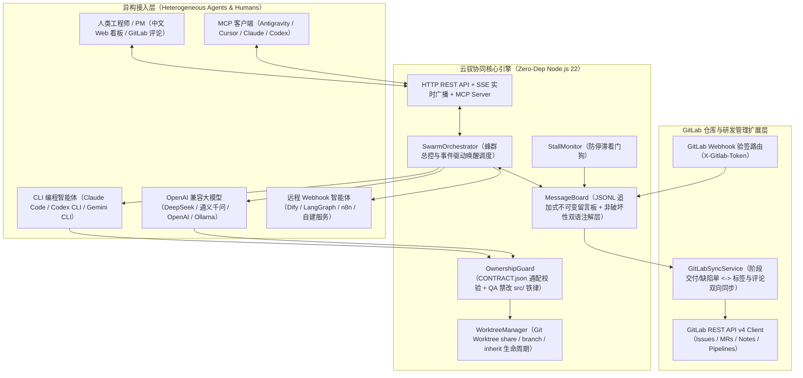
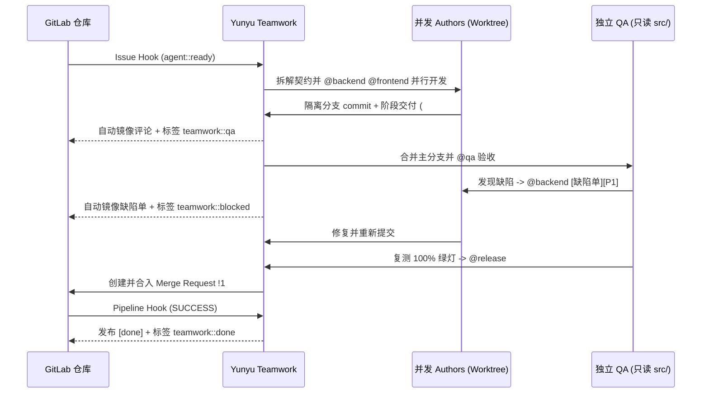

# 系统架构深度解析（Architecture Deep Dive）

**云驭协同（Yunyu Teamwork）** 的架构吸收并工程化扩展了现代多 Agent 蜂群协同（Swarm）的核心理念：**共享不可变留言板 + `@mention` 零轮询事件唤醒 + Git Worktree 物理隔离 + 文件所有权契约（`CONTRACT.json`）+ 作者/验证者读写分离 + GitLab 双向项目管控**。

---

## 1. 总体系统拓扑

---

## 2. 六大核心机制

### 2.1 追加式不可变留言板与非破坏性双语注解（`src/core/board.mjs`）
- **单调递增 `#seq` 审计轨迹**：每条发帖按序赋予唯一 `#seq` 并持久化至 `.yunyu/swarms/<id>/events.jsonl`，支持服务重启后 100% 重放恢复。
- **`@mention` 门铃唤醒语义**：
  - `@member`：精准唤醒单个成员（或以 `@worker` 唤醒编号分片组 `worker-1..k`）。
  - `@#channel`：唤醒已订阅该频道的成员（主频道 `main` 禁止 `@#main`，请改用 `@all`）。
  - `@all`：全局广播，唤醒全部活跃成员（仅用于全局决策或公共契约变更）。
  - `#12`：引用历史序号，避免在多 Agent 交接时重复粘贴长篇报告，显著降低上下文 Token 开销。
- **非破坏性双语注解层（Translation Overlay）**：若接入英文外部 Agent 或英文 CI 机器人，可通过 `POST /api/swarms/:id/messages/:seq/translate` 附加 `zh-CN` 中文译文注解事件，**绝不篡改原始不可变消息**，在 Web 看板与图谱时间轴中支持一键切换「中文译文 / 查看原文」。

### 2.2 文件所有权契约与作者/验证者隔离（`src/core/ownership.mjs`）
- 支持通过 `CONTRACT.json` 或 API 定义全局禁止路径（`globalForbidden`，如 `dist/**`）以及每位成员的 `owns` / `mustNotTouch` 路径通配符。
- **硬不变量（Hard Invariant）**：凡是 `role === "verifier"` 或名称为 `qa` 的成员，自动强制封锁 `src/**`、`web/**`、`app/**`、`lib/**` 写权限；任何工具调用（`write_file` / `edit_file`）或 Git 提交/合并都会被 `OwnershipGuard` 拦截并写入审计日志。
- **冲突预警（`detectCollisions()`）**：自动检测并行作者的 `owns` 范围是否重叠，提前暴露并发修改同一文件的风险。

### 2.3 真实 Git Worktree 物理隔离（`src/core/worktree.mjs`）
| 工作区模式 | 底层 Git 行为 | 适用角色 |
| :--- | :--- | :--- |
| `share` | `git worktree add -b yunyu/<swarm>/<agent> <dir> <base>`（共享 `.git` 对象库，零存储冗余） | 并发编写代码与执行构建的 Author / Architect |
| `branch` | `git clone --no-hardlinks` + 独立特性分支 | 深度重构或实验性探索任务 |
| `inherit` | 共享主工作目录（配合 `OwnershipGuard` 限制可写范围） | 只读审查者、独立 QA 验证官、发布官 |

- 合并前强制通过 `OwnershipGuard.auditChangedFiles()` 审计变更列表。
- 销毁成员（`kill`）时，若其隔离分支仍有未合并改动且未传 `force: true`，系统将拒绝删除，防止工作成果丢失。

### 2.4 防停滞看门狗（`src/core/monitor.mjs`）
- 周期性检查非监控成员状态：当所有成员均处于 `waiting` / `waiting_human` / `error` 且静默时长超过阈值、同时看板尚未出现 `[done]` 时，精准定位阻塞的 `#seq`，向 `@coordinator [stall]` 或对应人工门禁节点发送提醒。
- 一旦协调者发布不带 `@` 的 `[done] <摘要>`，看门狗自动停止计时。

### 2.5 异构 Agent 驱动抽象层（`src/drivers/`）
所有异构 Agent 统一实现 `AgentDriver.executeTurn(ctx)` 契约，共享同一留言板与守卫工具箱：
1. `openai-compatible`：原生支持 OpenAI、DeepSeek、通义千问、智谱 GLM、Moonshot、OpenRouter、vLLM、Ollama（内置安全工具调用循环）。
2. `cli-agent`：内置 `claude-code`、`codex-cli`、`gemini-cli` 与自定义命令模板，直接在隔离 Worktree 内启动子进程并注入 `YUNYU_*` 环境变量。
3. `webhook`：通过 HMAC-SHA256 签名的 HTTP POST 对接 LangGraph、Dify、n8n、AutoGen 与企业微服务。
4. `human`：人类成员无缝进入同一留言板，支持 Web 看板实时 `@` 交互与人工审批门禁。
5. `simulated`：零 API Key 确定性演练与自动化集成测试驱动。

### 2.6 GitLab 研发管理双向闭环（`src/gitlab/`）

