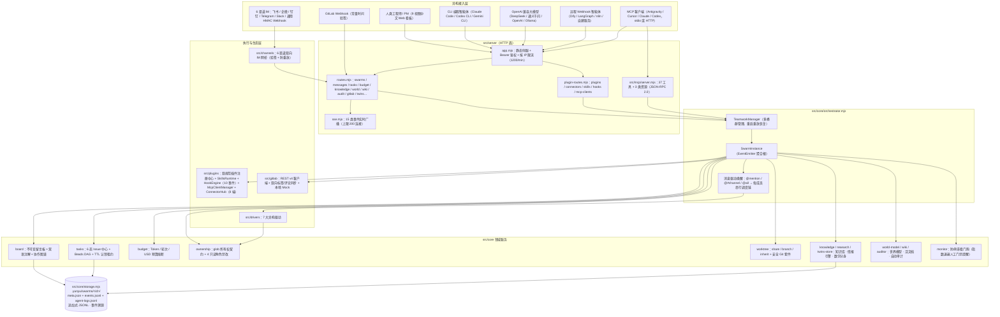
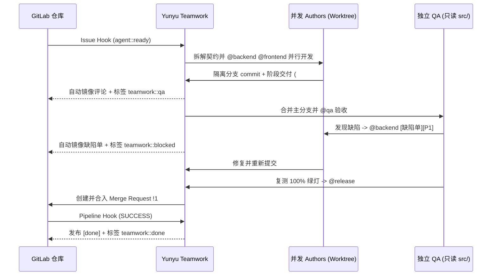

# 系统架构深度解析（Architecture Deep Dive）

> **对应版本：v0.5.1**（2026-11-22 依据全仓代码实测重写，待办 D-01）。
> **文档分工**（见 [评审档案 02 §3.1](review/02-doc-comparison.md)）：本文承载**架构叙事与设计决策**；模块拓扑/导出符号/LOC 指标以自动生成的 [docs/wiki/*](wiki/README.md) 为唯一事实源（`npm run wiki` 再生成，禁止手改）；带行号证据的实测现状基线见 [review/01-architecture-baseline.md](review/01-architecture-baseline.md)；工程契约与 6 条硬不变量以 [AGENTS.md](../AGENTS.md) 为最高优先级。

**云驭协同（Yunyu Teamwork）** 的架构吸收并工程化扩展了现代多 Agent 蜂群协同（Swarm）的核心理念：**共享不可变留言板 + `@mention` 零轮询事件唤醒 + Git Worktree 物理隔离 + 文件所有权契约（`CONTRACT.json`）+ 作者/只读审查角色读写分离 + GitLab 双向项目管控**，并在 v0.3–v0.5 演进中叠加了 **Issue 中心与预算治理、共享知识库与情报引擎、项目世界模型与活文档 Wiki、自动审计器、数字分身、Agent 插件与 TeamAI 生态、6 渠道 IM 网桥**。

---

## 1. 总体系统拓扑（v0.5.1 全景）

依赖方向健康：`server → core`、`drivers → core`、`plugins → core`，**全仓 0 循环依赖**（世界模型实测，指标见 [wiki/home.md](wiki/home.md)）。

---

## 2. 核心机制

### 2.1 追加式不可变留言板与非破坏性双语注解（`src/core/board.mjs`）
- **单调递增 `#seq` 审计轨迹**：每条发帖按序赋予唯一 `#seq` 并持久化至 `.yunyu/swarms/<id>/events.jsonl`，支持服务重启后 100% 重放恢复。
- **`@mention` 门铃唤醒语义**：
  - `@member`：精准唤醒单个成员（或以 `@worker` 唤醒编号分片组 `worker-1..k`）。
  - `@#channel`：唤醒已订阅该频道的成员（主频道 `main` 禁止 `@#main`，请改用 `@all`）。
  - `@all`：全局广播，唤醒全部活跃成员（仅用于全局决策或公共契约变更）。
  - `#12`：引用历史序号，避免在多 Agent 交接时重复粘贴长篇报告，显著降低上下文 Token 开销。
- **非破坏性双语注解层（Translation Overlay）**：若接入英文外部 Agent 或英文 CI 机器人，可通过 `POST /api/swarms/:id/messages/:seq/translate` 附加 `zh-CN` 中文译文注解事件，**绝不篡改原始不可变消息**，在 Web 看板与图谱时间轴中支持一键切换「中文译文 / 查看原文」。
- **事件溯源单一事实源**：同一份 `events.jsonl` 由 board / tasks / knowledge / wiki 四个模块各自重放重建内存态；重启恢复即「重放全部事件」。

### 2.2 文件所有权契约与作者/只读审查角色隔离（`src/core/ownership.mjs`）
- 支持通过 `CONTRACT.json` 或 API 定义全局禁止路径（`globalForbidden`，如 `dist/**`）以及每位成员的 `owns` / `mustNotTouch` 路径通配符。
- **硬不变量（Hard Invariant #3）**：凡是 `role` 属于 **`verifier` / `reviewer` / `researcher` / `qa`** 四只读角色的成员，自动强制封锁 `src/**`、`web/**`、`app/**`、`lib/**` 写权限，并禁止调用任意 `run_command`；任何工具调用（`write_file` / `edit_file`）或 Git 提交/合并都会被 `OwnershipGuard` 拦截并写入审计日志。发现缺陷必须通过 `@author` 结构化缺陷单或 Qoder Issue 流转。
- **冲突预警（`detectCollisions()`）**：自动检测并行作者的 `owns` 范围是否重叠，提前暴露并发修改同一文件的风险。
- 防 `..` 路径穿越与大小写绕过；合并/提交前强制 `auditChangedFiles()` 越权审计。

### 2.3 真实 Git Worktree 物理隔离（`src/core/worktree.mjs`）
| 工作区模式 | 底层 Git 行为 | 适用角色 |
| :--- | :--- | :--- |
| `share` | `git worktree add -b yunyu/<swarm>/<agent> <dir> <base>`（共享 `.git` 对象库，零存储冗余） | 并发编写代码与执行构建的 Author / Architect |
| `branch` | `git clone --no-hardlinks` + 独立特性分支 | 深度重构或实验性探索任务 |
| `inherit` | 共享主工作目录（配合 `OwnershipGuard` 限制可写范围） | 只读审查者、独立 QA 验证官、发布官 |

- 合并前强制通过 `OwnershipGuard.auditChangedFiles()` 审计变更列表。
- 销毁成员（`kill`）时，若其隔离分支仍有未合并改动且未传 `force: true`，系统将拒绝删除，防止工作成果丢失。
- `rehydrate` 重启自动修复；Windows 8.3 短路径经 `realpathSync.native` 规范化；`-c core.quotePath=false status --porcelain -uall` 防中文转义与首空格截断。

### 2.4 Qoder 风格 Issue 中心与预算治理（`src/core/tasks.mjs` / `budget.mjs`，v0.3+）
- **6 态 Issue 生命周期**：Planning → Ready → In Progress → Pending Acceptance（review）→ Done / Cancelled（`ISS-N`），Spec 冻结与验收清单、Beads DAG 环检测、TTL 认领租约防占坑。
- `kind=defect` 留言板消息自动派生缺陷单；上游 Issue 须由协调者 `accept`（→done）后下游依赖才解锁。
- **Paperclip 风格预算熔断**：蜂群与成员级 Token / 轮次 / USD 上限，80% 独立预警、100% 硬熔断停机。

### 2.5 防停滞看门狗（`src/core/monitor.mjs`）
- 15s 巡检：当所有成员均处于 `waiting` / `waiting_human` / `error` 且静默超过阈值、同时看板尚未出现 `[done]` 时，精准定位阻塞的 `#seq`，向 `@coordinator [stall]` 发送提醒。
- `waiting_human` 人工门禁提醒按 30s→60→120→240→480s 指数退避（v0.5.1），门禁解除即复位。
- 一旦协调者发布不带 `@` 的 `[done] <摘要>`，看门狗自动静默停机。系统告警携带 `metadata.noWake: true`，严禁 `@member` 语法以防自触发唤醒环。

### 2.6 异构 Agent 驱动抽象层（`src/drivers/`，7 大驱动）
所有异构 Agent 统一实现 `AgentDriver.executeTurn(ctx)` 契约，共享同一留言板与守卫工具箱：
1. `openai-compatible`：原生支持 OpenAI、DeepSeek、通义千问、智谱 GLM、Moonshot、OpenRouter、vLLM、Ollama（内置安全工具调用循环，90s 出站超时）。
2. `cli-agent`：内置 `claude-code`、`codex-cli`、`gemini-cli` 与自定义命令模板，直接在隔离 Worktree 内启动子进程并注入 `YUNYU_*` 环境变量，流式日志与 `--resume` 会话复用。
3. `research-synthesizer`（v0.3+）：只读 `researcher` 角色，采集本地仓库片段 + SSRF 加固的 Web 来源 + 蜂群历史，产出带引用的情报简报入知识库。
4. `digital-twin`（v0.4+）：挂载 `.yunyu/twins.json` 个人数字分身模板，`hybrid` 模式可升级至真人（经 IM 渠道）。
5. `webhook`：通过 HMAC-SHA256 签名的 HTTP POST 对接 LangGraph、Dify、n8n、AutoGen 与企业微服务。
6. `human`：人类成员无缝进入同一留言板，支持 Web 看板实时 `@` 交互与人工审批门禁。
7. `simulated`：零 API Key 确定性演练与自动化集成测试驱动。

base 层统一提供：守卫工具集与路径/符号链接逃逸防护、只读角色工具限制、子进程敏感环境变量剥离。

### 2.7 项目世界模型、活文档 Wiki 与自动审计器（`src/core/world-model.mjs` / `wiki.mjs` / `auditor.mjs`，v0.4+）
- **世界模型**：零依赖静态 AST/词法扫描构建模块拓扑、高扇入枢纽排名、循环依赖检测；`simulateChangeImpact` 预编辑爆炸半径预测（直接/传递依赖方、受影响测试、需通知所有者、不变量警告）。
- **活文档 Wiki**：从世界模型 + 知识库 + 审计报告自动合成多页档案，追加式修订持久化于 `events.jsonl`，Web UI 可内联编辑，`yunyu wiki` 导出 Markdown 至 `docs/wiki/`。
- **自动审计器**：`yunyu audit` 检查零运行时依赖、硬编码密钥、`eval`/`new Function`/模板表达式注入、Shell 拼接、循环依赖、所有权重叠、超大文件与版本一致性。

### 2.8 Agent 插件与 TeamAI 生态层（`src/plugins/`，v0.5+）
- **双规范插件注册中心**：同时支持 Agent Plugin 开放标准（`plugin.json`）与腾讯 `teamai-cli` Git 资产规范（`teamai.yaml` / `mcp/mcp.yaml` / `hooks/hooks.yaml`）；内置 `yunyu-engineering-pack` 与 `teamai-sync-pack`。
- **8 端连接器非破坏性同步**：探测 Claude Code / Codex / Gemini / Cursor / OpenCode / Antigravity / CodeBuddy / MCP 网关，`--dry-run` 预览或仅深度合并 `mcpServers` 等目标键，严禁覆写用户既有配置。
- **外部 MCP 客户端管理器**：HTTP 与受信 stdio 双传输，按服务器故障隔离，动态桥接 `mcp__<srv>__<tool>`。
- **渐进式 Skills/规则运行时 + 10 事件 Hook 引擎**：`SessionStart` / `PreTurn` / `PreToolUse` / `PreCommit` / `PreMerge` 等生命周期策略钩子，追加式 `.yunyu/hooks-audit.jsonl` 审计；**Hook 只能收紧不能放宽**。
- **零信任授信**：自动扫描/HTTP 安装的插件强制 `trusted: false`（忽略自声明）；授信开关受 `YUNYU_ALLOW_EXEC_HOOKS` / `YUNYU_ALLOW_MCP_STDIO` / `allowCustomCli` 门禁；`lstatSync` + `realpathSync` 拒绝符号链接逃逸。

### 2.9 6 渠道 IM 双向网桥（`src/channels/`，v0.3+）
飞书/Lark、企微、钉钉、Telegram、Slack/Discord、通用 HMAC-SHA256 Webhook 六渠道适配器 + `ChannelBridge`：常量时间验签、300s 防重放窗口，人类可在 IM 中直接 `@` 蜂群成员，数字分身 `hybrid` 升级经此触达真人。

### 2.10 GitLab 研发管理双向闭环（`src/gitlab/`）

---

## 3. 安全门禁次序（不可颠倒）

`OwnershipGuard`（4 只读角色禁改 src/web）→ 零信任插件授信（`trusted:false` 默认 + 双环境开关）→ Hook 只能收紧不能放宽 → 预算熔断 → 驱动执行 → 变更文件越权审计（合并/提交前）。

认证与部署（v0.5.1）：单一全局 Bearer Token（`timingSafeEqual`）；非回环绑定强制 token 否则拒绝启动；按 IP 限流 1200/min（`/api/health` 豁免）；`GET /api/metrics` 巡检指标；Dockerfile 非 root + HEALTHCHECK。详见 [SECURITY.md](../SECURITY.md) 与 [HANDOFF §5](HANDOFF.md)。

**已知信任缺口与演进规划**（双进程无锁写、密钥明文落盘、author 可冒充等 P0 项）不在本文重复展开，统一见 [review/01 §5–§7](review/01-architecture-baseline.md) 与 [review/backlog.json](review/backlog.json)。

---

## 4. 隐含架构决策（ADR 摘要）

| # | 决策 | 收益 | 代价 / 风险 |
| :--- | :--- | :--- | :--- |
| ADR-1 | 零外部运行时依赖 | 内网离线开箱即用、零供应链风险 | 存储/查询/加密/SSO 需手写或用 Node 内置（`node:sqlite` 为潜在破局点，待决策门 D2） |
| ADR-2 | 事件溯源 + JSONL 追加不可变 | 完整审计、重启重放、符合不变量 #2 | 全量重放 O(n)，4 消费者重复解析；无索引查询 |
| ADR-3 | 单进程内存聚合根 | 实现简单、零 IPC、唤醒低延迟 | 无水平扩展、双实例写冲突、进程崩溃即全员停摆 |
| ADR-4 | 单全局 token | 部署极简 | 无最小权限、无人员审计归因、author 可冒充 |
| ADR-5 | 原生 ESM 前端无构建 | 零工具链、离线可用 | 无类型检查、状态管理靠约定 |
| ADR-6 | 同步 fs API | 代码简单、单进程内无异步竞态 | 大文件阻塞事件循环，吞吐上限低 |

> 决策论证与拍板记录将落入 `docs/adr/`（待办 D-05）；企业级演进讨论入口见 [review/README.md](review/README.md)。