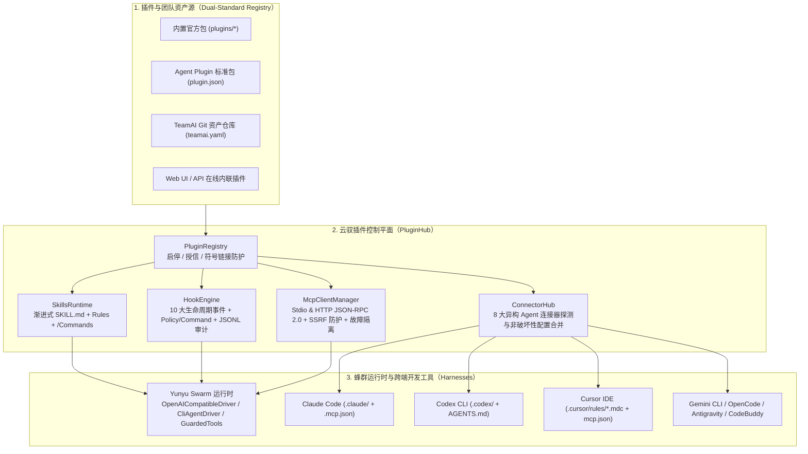

# Agent 插件生态、TeamAI 跨端同步、外部 MCP 连接器、技能与 Hook 指南（v0.5.0）

**云驭协同（Yunyu Teamwork）v0.5.0** 引入了完整的**零外部运行时依赖 Agent 插件与跨端连接器控制平面（`src/plugins/`）**，同时原生兼容 **Agent Plugin Open Standard（`plugin.json`）** 与腾讯开源 **[`Tencent/teamai-cli`](https://github.com/Tencent/teamai-cli) Git 单一事实源资产规范（`teamai.yaml`）**，并融合了 **[`phodal/routa`](https://github.com/phodal/routa)** 的确定性生命周期守卫 Hook 思想。

---

## 1. 架构全景：从连接器 CLI / MCP 到技能与生命周期 Hook



---

## 2. 双规范插件包目录结构（Agent Plugin Standard & TeamAI Git Repo）

云驭协同支持自动扫描 `plugins/`（内置）、`<repo>/.yunyu/plugins/`（工作区）、`.yunyu/plugins/`（已安装）中的两类目录结构：

```text
my-team-plugin/
├── plugin.json 或 teamai.yaml          # 插件清单（id / name / version / description / tags）
├── skills/
│   └── tdd-guard/
│       └── SKILL.md                    # 含 YAML Frontmatter (name / description / tags / triggers / globs / roles)
├── rules/
│   └── zero-dep-chinese-first.md       # 常驻或按 globs/roles 作用域注入的团队工程规则
├── commands/
│   └── preflight.md                    # 可在留言板通过 /preflight 直接触发展开的斜杠命令模板
├── agents/
│   └── sec-auditor.yaml                # 专职 Agent 模板（支持在 Web 看板一键「+ 招募入群」）
├── hooks/
│   └── hooks.json 或 hooks.yaml        # 生命周期守卫策略（policy / builtin / command）
└── mcp/
    └── mcp.json 或 mcp.yaml            # 外部 MCP Server 声明（http 或受信任 stdio）
```

### 内置两大官方插件包
1. **`yunyu-engineering-pack`（云驭工程铁律与安全护栏插件包）**：
   - 技能：`tdd-guard`（TDD 红绿重构规程）、`security-review`（OWASP & 多 Agent 边界审计）
   - 规则：`zero-dep-chinese-first`（零外部依赖与中文优先交付铁律）
   - 命令：`/preflight`（发版前自检清单）
   - Hooks：`guard-destructive-shell`（拦截 `rm -rf /`、`git push --force` 等高危命令）、`guard-secret-write`（拦截 `sk-`/`ghp_`/`glpat-`/`AKIA`/私钥写入源码）、`remind-chinese-deliverable`（`PreTurn` 交付规范提醒）
   - 专职 Agent：`@sec-auditor`（只读安全审计官）
2. **`teamai-sync-pack`（TeamAI 团队资产协同包）**：
   - 技能：`team-onboarding`（新 Agent 入群与世界模型对齐规程）
   - 规则：`commit-convention`（语义化提交与 Issue 关联规范）
   - 命令：`/sync-team`（跨端同步指引）
   - Hooks：`session-start-world-sync`（`SessionStart` 自动刷新项目世界模型）、`warn-wip-commit`（`PreCommit` 提醒清理 `WIP/FIXME` 标记）
   - MCP 连接器：`yunyu-local-mcp`（本地云驭 MCP HTTP 网关自检连接器）
   - 专职 Agent：`@wiki-curator`（活文档 Wiki 档案维护官）

---

## 3. 跨端连接器雷达与 TeamAI 一键配置同步（8 Harnesses）

参考 `Tencent/teamai-cli` 的多端 Adapter 设计，`ConnectorHub` 支持自动探测本机 CLI/IDE 状态，并将当前启用的 **Skills、Rules、Commands、Hooks 与 MCP Servers** **非破坏性合并（Non-Destructive Merge）** 到各工具原生配置目录：

| 连接器 ID | 目标工具 | 同步生成的原生配置文件（保留既有用户键） |
| :--- | :--- | :--- |
| `claude-code` | Claude Code CLI | `.claude/skills/<name>/SKILL.md`、`.claude/commands/<cmd>.md`、`.claude/rules/yunyu-team-rules.md`、`.mcp.json`、`.claude/yunyu-hooks.json` |
| `codex-cli` | OpenAI Codex CLI | `.codex/skills/<name>/SKILL.md`、`.codex/rules/yunyu-team-rules.md`、`.codex/mcp.json` |
| `cursor` | Cursor IDE | `.cursor/rules/<name>.mdc`（含 `globs` 与 `alwaysApply`）、`.cursor/skills/<name>/SKILL.md`、`.cursor/mcp.json` |
| `gemini-cli` | Google Gemini CLI | `.gemini/skills/<name>/SKILL.md`、`.gemini/GEMINI.team.md`、`.gemini/settings.json`（深度合并 `mcpServers`） |
| `opencode` | OpenCode CLI | `.opencode/skills/<name>/SKILL.md`、`opencode.json`（深度合并 `mcp`） |
| `antigravity` | Antigravity (AGY) | `.agent/skills/<name>/SKILL.md`、`.agent/rules/*.md`、`.agent/commands/*.md`、`.agent/mcp.json`、`.agent/hooks.json` |
| `codebuddy` | CodeBuddy / TeamAI | `.codebuddy/skills/<name>/SKILL.md`、`.codebuddy/rules/*.md`、`.codebuddy/mcp.json`、`.codebuddy/hooks.json` |
| `mcp-gateway` | 标准 MCP / TeamAI 归档 | `.teamai/skills/*`、`.teamai/rules/*`、`.teamai/mcp.json`、`.teamai/hooks.json` |

### CLI 使用示例
```bash
# 1. 探测本机 8 大异构 Agent 连接器与当前仓库配置状态
node bin/yunyu.mjs connectors

# 2. 列出所有已启用插件包与资产计数
node bin/yunyu.mjs plugin list

# 3. 预览将团队技能/规则/MCP/Hook 同步至 Claude Code 或 Cursor（Dry-Run 不落盘）
node bin/yunyu.mjs plugin sync --harness claude-code --dry-run
node bin/yunyu.mjs plugin sync --harness cursor

# 4. 从远端 TeamAI Git 仓库安装或启停插件
node bin/yunyu.mjs plugin install https://github.com/your-org/team-ai-rules.git
node bin/yunyu.mjs plugin disable teamai-sync-pack
node bin/yunyu.mjs plugin enable teamai-sync-pack
```

---

## 4. 渐进式技能披露（Progressive Disclosure）与动态外部 MCP 工具桥接

- **按需渐进式技能注入（`SkillsRuntime`）**：
  - 避免一次性将所有 `SKILL.md` 塞入 System Prompt 导致上下文膨胀。
  - 每轮唤醒时根据任务文本、触发词（`triggers`）、标签（`tags`）、成员角色（`role`）与负责路径（`owns`/`globs`）动态打分，仅注入 Top-2 高匹配技能正文 + 完整技能摘要目录；Agent 可在需要时主动调用 `skill_read` 或 `skill_match` 工具按需深读。
- **外部 MCP Client 动态桥接（`McpClientManager`）**：
  - 支持连接外部 **HTTP JSON-RPC 2.0** 与受信任 **stdio** MCP Server，内置**单服务故障隔离**（单个外部 MCP 超时或崩溃绝不阻塞蜂群主进程）。
  - 已连接外部 MCP Server 发现的工具会自动以 `mcp__<serverId>__<toolName>` 命名空间桥接注入 `OpenAICompatibleDriver` 的可用工具集（只读角色 `verifier`/`reviewer`/`researcher`/`qa` 自动隔离写操作外部 MCP 调用，坚守硬不变量 #3）。

---

## 5. 10 大生命周期 Hook 与零信任安全模型（`HookEngine`）

支持 10 个标准生命周期事件：`SessionStart`、`PreTurn`、`PostTurn`、`PreToolUse`、`PostToolUse`、`OnMessage`、`PreCommit`、`PreMerge`、`OnIssueTransition`、`OnAudit`，所有触发记录以追加式持久化至 `.yunyu/hooks-audit.jsonl`。

### 多层安全防线
1. **所有权守卫绝对优先**：`OwnershipGuard` 与只读角色隔离在任何 Hook 之前强制执行；Hook 只能**收紧**安全边界（如拦截破坏性命令或硬编码密钥），绝不能绕过或削弱 `OwnershipGuard`。
2. **默认零 Shell 确定性策略（`type: "policy"`）**：内置 ReDoS 静态检测与长度上限，无需启动子进程即可实现毫秒级正则/通配拦截（`deny`）、告警（`warn`）或上下文注入（`inject_context`）。
3. **命令型 Hook 与 Stdio MCP 双重授信门禁**：
   - 工作区自动发现或通过 HTTP 安装的外部插件默认强制 `trusted: false`（忽略插件自带的 `manifest.trusted` 声明，防零点击供应链投毒）。
   - 仅当插件被显式授予信任（`trusted: true`）**且**服务端显式开启 `YUNYU_ALLOW_EXEC_HOOKS=true` / `YUNYU_ALLOW_MCP_STDIO=true` 时，才允许执行子进程命令，且子进程自动剥离宿主 `TOKEN`/`KEY`/`SECRET`/`PASSWORD` 等敏感环境变量。
