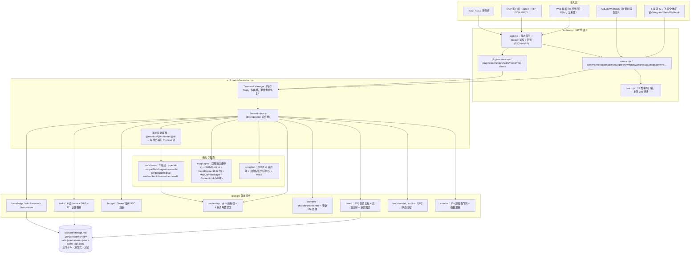

# 云驭协同 v0.5.1 架构基线（讨论稿）

> **本文档目的**：为架构师、开发者、QA、安全、SRE、产品与各类 AI Agent 提供一份**与代码实测一致**的现状基线，作为企业级演进讨论的共同出发点。
> **证据约定**：所有关键论断附 `文件:行号`；本文由 2026-11-22 全仓代码勘察 + 文档比对生成。`docs/ARCHITECTURE.md` 已于同日依据本基线重写至 v0.5.1（待办 D-01 交付），本文保留行号级实测证据与讨论基线职能。
> **配套文档**：[02 文档对比分析](02-doc-comparison.md) · [03 多视角批判与企业级路线图](03-enterprise-roadmap.md) · [backlog.json](backlog.json)（机器可读待办）
> **最高契约**：[AGENTS.md](../../AGENTS.md) 的 6 条硬不变量在本文全程视为约束前提。

---

## 1. 系统定位与规模

**一句话**：零外部运行时依赖（Node.js ≥ 22 内置模块）的**单进程多 Agent 蜂群协同研发与项目管理平台**——异构 AI Agent 与人类在共享不可变留言板上，经文件所有权守卫与 Git Worktree 物理隔离，完成调研 → 规划 → 并发开发 → 验收 → 发布全流程，并与 GitLab 双向联动。

当前规模（世界模型自动扫描，`docs/wiki/home.md`，2026-11-22）：

| 指标 | 数值 |
| :--- | :--- |
| 扫描文件 | 143（源码 91 / 测试 25 / 文档 35） |
| 总行数 | 30,456 LOC |
| 模块导出 / 依赖边 / 循环依赖 | 196 / 268 / **0** |
| 外部运行时依赖 | **0** |
| 核心域行数 Top3 | core 7,116 · web 6,245 · tests 4,258 |

**官方定位边界**（`docs/HANDOFF.md:112`）：「内网单节点团队协作，非多租户 SaaS」。⚠️ 这与「企业级项目管理平台」目标之间的张力是本次演进的第一决策点（见 03 文档 §5 决策门 D1）。

---

## 2. 分层拓扑（v0.5.1 实测全景）

依赖方向健康：`server → core`、`drivers → core`、`plugins → core`，core 对 gitlab/plugins 仅少量反向边，**全仓 0 循环依赖**（世界模型实测）。

---

## 3. 核心运行时机制（讨论重点）

### 3.1 事件溯源：一份 JSONL，四个重放消费者
- 唯一持久层 `src/core/storage.mjs`：每蜂群 `.yunyu/swarms/<id>/` 下 `meta.json`（tmp+rename 原子写，storage.mjs:67-69）、`events.jsonl`（`appendFileSync` 追加，storage.mjs:94）、`agent-logs.jsonl`。
- **同一份 `events.jsonl` 被 4 个模块各自全量重放**：board（board.mjs:73）、tasks（tasks.mjs:82）、knowledge（knowledge.mjs:35）、wiki（wiki.mjs:71）。重启恢复即「重放全部事件重建内存态」。
- 读路径 `readEvents` 每次**全量读文件逐行 JSON.parse**（storage.mjs:104-116），坏行静默丢弃（storage.mjs:110-114）；无索引、无分页、无压缩、无文件锁。
- 消息全量驻内存（board.mjs:56-59），`read`/`buildGraph` 为 O(n) 线性过滤（board.mjs:290-346）。

### 3.2 调度：消息驱动唤醒 + 每成员串行
- board `message` 事件 → `_resolveWaiters` + `_scheduleWakeups`（orchestrator.mjs:226-227）；`_shouldWakeMember` 按 @提及/频道订阅判定（orchestrator.mjs:706-721）。
- 每成员一条串行 Promise 链 `_activeDispatches`（orchestrator.mjs:741-916）：预算前置熔断（:751）→ PreTurn Hook（:769）→ `driver.executeTurn(ctx)` → PostTurn Hook（:851）→ 回帖。
- `waitForMention` 长轮询实现 MCP 侧零算力等待（orchestrator.mjs:672）。
- 看门狗：15s 巡检 / 30s 停滞阈值（monitor.mjs:12-13），全员非 working 且超时 → `[stall]` 唤醒 coordinator（monitor.mjs:94-97）；`waiting_human` 30→480s 指数退避（monitor.mjs:74-81）。

### 3.3 驱动契约
`AgentDriver.executeTurn(ctx) → {reply, channel, kind, alreadyPosted, tokensUsed, sessionId}`（drivers/base.mjs:66-72），经 `DriverRegistry.register` 注册（registry.mjs:14,31-46）。base 层统一提供：守卫工具集与路径/符号链接逃逸防护（base.mjs:78-105）、只读角色工具限制（base.mjs:7-20）、子进程敏感环境变量剥离（base.mjs:22-32）。

### 3.4 安全门禁次序（不可颠倒）
`OwnershipGuard`（4 只读角色禁改 src/web）→ 零信任插件授信（`trusted:false` 默认 + 双开关 `YUNYU_ALLOW_EXEC_HOOKS`/`YUNYU_ALLOW_MCP_STDIO`）→ Hook 只能收紧不能放宽 → 预算熔断 → 驱动执行 → 变更文件越权审计（合并/提交前）。

---

## 4. 接口面清单

| 面 | 规模 | 关键位置 |
| :--- | :--- | :--- |
| REST API | ~20 路由组（swarms/messages/tasks 全生命周期/budget/knowledge/research/graph/members/channels/world-model/wiki/audit/ownership/worktrees/gitlab/twins/mcp） | src/server/routes.mjs:151-1162 |
| 插件 REST | plugins/connectors/skills/hooks/mcp-clients | src/server/plugin-routes.mjs（436 行） |
| SSE | 15 类事件：connected/message/translation/status/channel/human_required/agent_log/task/knowledge/wiki/world_model/audit/swarm_created/plugins_changed/hook_run；上限 200 连接 | orchestrator.mjs:1177-1188、sse.mjs:5 |
| MCP | **37 工具**（8 组）+ 3 类资源，stdio 与 HTTP 双传输 | src/mcp/server.mjs:9-445,507-528 |
| CLI | serve/demo/audit/wiki/plugin/connectors/init/status/post/doctor | bin/yunyu.mjs:394-422 |
| IM | 6 渠道双向，防重放窗口 300s | src/channels/adapters.mjs:4,43-46 |

---

## 5. 认证与信任模型（现状）

- **单一全局 Bearer Token**（`YUNYU_API_TOKEN`，timingSafeEqual 比较，routes.mjs:35-53）；未设 token 时回环地址全放行；非回环绑定强制 token 否则拒绝启动（rate-limit.mjs:51-59，`YUNYU_ALLOW_INSECURE=true` 可显式豁免——逃生门需在部署规范中管控）。
- ⚠️ **支持 `?token=` 查询串鉴权**（routes.mjs:47-48）：token 会泄入反向代理访问日志、浏览器历史与 Referer（待办 S-03）。
- **无用户体系 / 会话 / RBAC / 多租户**：token 持有者等价于超级管理员；`role` 仅是 Agent 工程角色（constants.mjs:18-30），不是人的权限。
- **发帖身份可任意声明**：`author: body.author || 'human'`（routes.mjs:381）——任何 token 持有者可以冒充任意成员（含 coordinator）发帖，审计轨迹的「作者」不可信。
- 限流：按 IP 固定窗口 1200/min（rate-limit.mjs:8），`/api/health` 豁免。
- Webhook/IM：常量时间验签 + 5 分钟防重放（SECURITY.md）。

## 6. 密钥与敏感数据（现状）

- `driverConfig.apiKey` **明文持久化**至 `meta.json`：`sanitizeForStorage` 仅剥离 function/symbol，不剥离密钥（orchestrator.mjs:27-42,419）；脱敏正则 `SENSITIVE_FIELD_RE` 只作用于 **API 响应层**（orchestrator.mjs:44+）。
- GitLab token 在 `persistToken: true` 时明文写入 meta.json（orchestrator.mjs:437-439）。
- 无静态加密、无轮换、无 secret store 对接；`.env` 明文。meta/events 写入权限已收紧（目录 0o700 / 文件 0o600，storage.mjs:93-94），**但 `agent-logs.jsonl` 的目录与追加均未设 mode**（storage.mjs:131-133），权限防线不完整。

## 7. 进程与部署模型（现状）

- **单进程单机**：蜂群全在内存 Map（orchestrator.mjs:1144），全同步 fs；无跨进程锁。
- ⚠️ **双实例隐患**：HTTP 服务（app.mjs:80-88）与 stdio MCP（bin/yunyu-mcp.mjs:10-14）**各自实例化 TeamworkManager 写同一 `.yunyu` 目录**，并发运行时存在 JSONL 交错追加与 meta.json 互相覆盖风险（`appendFileSync` 单次 write 在常规追加下近似原子，但 meta 全量重写无互斥）。
- 恢复脆弱面：损坏蜂群仅 console.error 跳过（orchestrator.mjs:1172）；JSONL 坏行静默丢弃；meta 与 events 双写无事务。
- 交付：Dockerfile（node:22-alpine、非 root、HEALTHCHECK）+ compose（强制 token、回环映射、数据卷）；TLS 交由前置反代；`/api/metrics` 提供巡检指标。
- 前端：单一可变全局 `state`（web/lib/state.js:3-60）+ SSE 驱动重渲染，原生 ESM 无构建。

### 7.1 运行时语义盲区（独立对抗复核新增，2026-11-22）

以下 6 项由第二个独立评审 Agent 对抗复核发现、经主评审逐行验证属实，均已纳入 backlog：

1. **SSE 断线即丢事件**：帧无 `id:` 字段、不支持 `Last-Event-ID` 补拉（sse.mjs:40-48），前端重连后无增量回补；`broadcast` 忽略 write 背压（sse.mjs:45）。→ C-04
2. **Webhook 异步回调无鉴权/无关联**：`async → alreadyPosted`（webhook-agent.mjs:62-64）后，远端回调走自报 author 的普通 POST；且出站 `fetch` 无超时/AbortSignal（webhook-agent.mjs:48-52，对比 openai-compatible.mjs 有 90s abort）——挂起的远端会永久阻塞该成员串行调度链。→ C-05
3. **GitLab 镜像静默失败 + 标签竞态**：sync 错误仅在有 error 监听器时 emit（orchestrator.mjs:254-257，而 :1177-1188 的转发未接 error），无重试/死信；标签读-改-写非原子（sync.mjs:54-61）；tasks 投影 `catch {}` 吞错（orchestrator.mjs:220-222）。→ C-06
4. **日志膨胀与写放大**：`agent-logs.jsonl` 磁盘无轮转（storage.mjs:133，内存态却有 500 条上限 :128）；每条消息全量重写 meta.json（orchestrator.mjs:224）。→ P-04
5. **POSIX 进程树清理不完整**：`killProcessTree` 在 POSIX 只杀直接子进程（cli-agent.mjs:386-398），CLI Agent 的孙进程（如 shell 包装的 node/python）泄漏；Windows `taskkill /T` 无此问题。→ C-07
6. **`?token=` 查询串鉴权**（见 §5）。→ S-03

---

## 8. 质量门禁现状

`npm run verify` = check（语法）+ test（15 单测 + 9 集成；2026-11-22 实测 **46/46 通过**，11.9s）+ qa:ui（CDP 双端 9 视图）+ audit（100/100，同日实测 PASS）。
**已覆盖**：功能正确性、安全回归（SSRF/越权/注入/零信任插件）、重启恢复、看门狗退避、限流。
**未覆盖**（勘察证实）：多进程并发写竞态、崩溃中途写入恢复、大数据量性能/压测、长稳内存增长、文档一致性（审计器版本检查覆盖 constants/bin/routes/mcp 源码字面量，auditor.mjs:375-389，但不查 README 徽章与派生数字，漂移因此漏网）。

---

## 9. 隐含架构决策（ADR 摘要，供讨论确认）

| # | 决策 | 收益 | 代价 / 风险 |
| :--- | :--- | :--- | :--- |
| ADR-1 | 零外部运行时依赖 | 内网离线开箱即用、零供应链风险 | 存储/查询/加密/SSO 全部需手写或用 Node 内置（`node:sqlite` 为潜在破局点） |
| ADR-2 | 事件溯源 + JSONL 追加不可变 | 完整审计、重启重放、符合不变量 #2 | 全量重放 O(n)，4 消费者重复解析；无索引查询 |
| ADR-3 | 单进程内存聚合根 | 实现简单、零 IPC、唤醒低延迟 | 无水平扩展、双实例写冲突、进程崩溃即全员停摆 |
| ADR-4 | 单全局 token | 部署极简 | 无最小权限、无人员审计归因、author 可冒充 |
| ADR-5 | 原生 ESM 前端无构建 | 零工具链、离线可用 | 无类型检查、无组件复用体系、状态管理靠约定 |
| ADR-6 | 同步 fs API | 代码简单、无异步竞态（单进程内） | 大文件阻塞事件循环，吞吐上限低 |

---

## 10. 开放讨论议题（人与 Agent 均可回帖）

1. **D1 定位**：企业级 = 「单节点企业内网平台」还是「多租户 SaaS」？（HANDOFF 现行定位 vs 用户目标）
2. **D2 零依赖边界**：`node:sqlite`（Node 22 内置，实验期需 flag）算不算违反不变量 #1？引入索引层是否保留 JSONL 为唯一审计事实源？
3. **D3 身份模型**：先做「人员账号 + RBAC + author 绑定」还是先做「跨进程单写者锁」？两者都是 P0 级信任缺口。
4. **D4 扩展路径**：垂直（单进程性能优化 + worker_threads）优先，还是水平（蜂群分片多进程）优先？
5. **D5 项目管理深度**：报表/工时/里程碑/审批流做到什么深度才称得上「企业级项目管理平台」，与 GitLab/GitHub 原生能力如何分工？
6. **D6 附件整合**：Genie-Teamwork 方案对比——用户已决定跳过（2026-11-22，附件缺失）；文件补充后可重启 G-01。

> 讨论产出请落入 [03-enterprise-roadmap.md](03-enterprise-roadmap.md) 的 backlog 与 ADR 决策记录，避免散落在留言板。