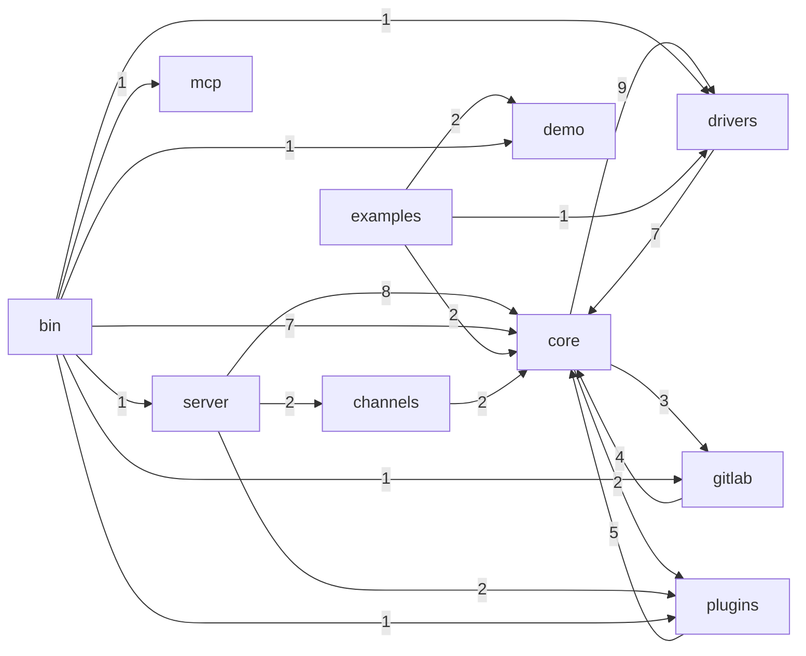

<!-- yunyu-wiki slug=architecture version=1 category=architecture updatedAt=2026-11-22T11:07:02.552Z -->
# 系统架构与模块依赖拓扑

## 1. 域间运行时依赖关系

## 2. 高扇入核心枢纽（变更前必做爆炸半径评估）

| 文件路径 | 所属域 | 被引用 (Fan-In) | 引用外部 (Fan-Out) | 行数 | 所有权 |
| :--- | :--- | ---: | ---: | ---: | :--- |
| `src/core/constants.mjs` | `core` | 39 | 0 | 128 | — |
| `src/core/orchestrator.mjs` | `core` | 16 | 16 | 1290 | — |
| `src/demo/showcase-scenario.mjs` | `demo` | 12 | 2 | 546 | — |
| `src/drivers/registry.mjs` | `drivers` | 12 | 7 | 47 | — |
| `src/drivers/base.mjs` | `drivers` | 11 | 2 | 567 | — |
| `src/server/app.mjs` | `server` | 11 | 9 | 229 | — |
| `src/core/ownership.mjs` | `core` | 10 | 1 | 249 | — |
| `src/core/storage.mjs` | `core` | 10 | 0 | 174 | — |
| `src/core/research.mjs` | `core` | 8 | 1 | 452 | — |
| `web/i18n.js` | `web` | 8 | 0 | 201 | — |
| `web/lib/state.js` | `web` | 8 | 0 | 157 | — |
| `src/core/world-model.mjs` | `core` | 6 | 1 | 875 | — |

## 3. 循环依赖与所有权边界检查

- 当前静态依赖图为严格有向无环图（DAG），**0 个循环依赖**。

- 文件所有权边界检查：**0 处作者路径重叠冲突**。
